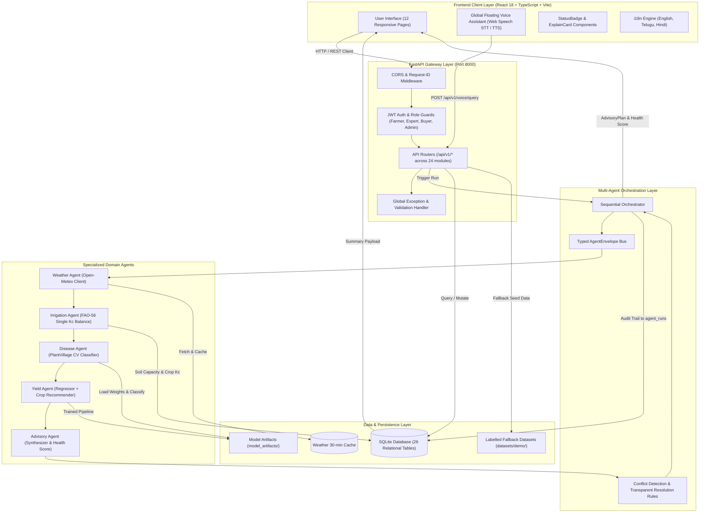

# AgriSage AI — System Architecture (`docs/ARCHITECTURE.md`)

**Yuktik 2026 Hackathon | Architecture & System Design**

---

## 1. High-Level System Architecture Diagram

---

## 2. Architectural Layers & Responsibilities

### 1. Client Layer (Frontend)
- **Framework**: Vite + React 18 in TypeScript strict mode.
- **Visual Design**: Earthy agricultural design system built with Tailwind CSS, utilizing high-contrast risk colors (green, amber, red) and large touch targets ($\ge 44\text{px}$) for mobile usability in rural field environments.
- **Data Visualization**: Recharts for responsive economics curves and 7-day soil water balance charts; Leaflet for zero-cost interactive mapping of mandis and aggregated village-level disease outbreaks.
- **Multilingual Support**: Real natural translations for English, Telugu, and Hindi stored in structured JSON dictionaries with Google Noto font glyph rendering.
- **Universal Voice Interface**: Floating component accessible from every view offering voice input (Web Speech API) and audio read-aloud capabilities (SpeechSynthesis) with graceful typed chat fallback.

### 2. API Gateway & Security Layer (Backend)
- **Framework**: FastAPI running under Python 3.12 ASGI.
- **Middleware**: CORS policy loaded dynamically from environment variables, unique Request-ID tracing, and standard structured JSON error responses.
- **Authentication**: Stateless PyJWT tokens issued upon login or one-click Demo Mode entry. Passwords hashed using bcrypt/argon2.
- **Role-Based Access Control (RBAC)**: Dependency guards restricting administrative workflows, seller verification, and marketplace moderation.

### 3. Multi-Agent Orchestration Layer
- **Sequential Pipeline**: Coordinates data handoffs across Weather, Irrigation, Disease, Yield, and Advisory agents via typed `AgentEnvelope` models.
- **Resilience & Degraded Execution**: Any agent encountering an unhandled exception or missing data reports status `degraded` or `failed` with diagnostic warnings; the pipeline continues without terminating the user request.
- **Conflict Resolution Engine**: Evaluates conflicting advice across domains with transparent agronomic rules (e.g. withholding overhead irrigation when fungal infection is active, or skipping watering when rain is imminent).

### 4. Domain Intelligence & Machine Learning Layer
- **Plant Disease Classifier**: MobileNet / ResNet model trained on PlantVillage running inference on CPU. Incorporates a pre-inference quality gate for image blur, lighting, and non-leaf rejection.
- **FAO-56 Irrigation Engine**: Calculates single crop coefficient evapotranspiration ($ET_c = K_c \times ET_0$) across 4 growth stages and simulates soil water balance by soil texture.
- **Economics Engine**: Computes cultivation costs, margins, and break-even points using `Decimal` arithmetic, separating owned land and leased land costs.
- **Crop Recommendation**: Machine learning model evaluating 7 soil/weather features with explicit fallback and confidence adjustments for missing inputs.

### 5. Persistence & Data Storage Layer
- **Database**: SQLite managed through SQLAlchemy 2.0 ORM with relational integrity, foreign keys, and indexes on location and temporal attributes.
- **Audit Trails**: Every agent run persists execution duration, inputs used, outputs, and warnings into the `agent_runs` table.
- **Privacy Boundary**: Exact farm coordinates and phone numbers never leave the database without explicit user consent. Outbreak maps and peer discovery consume only anonymized village centroid coordinates.

