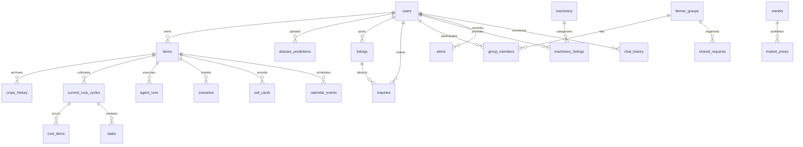
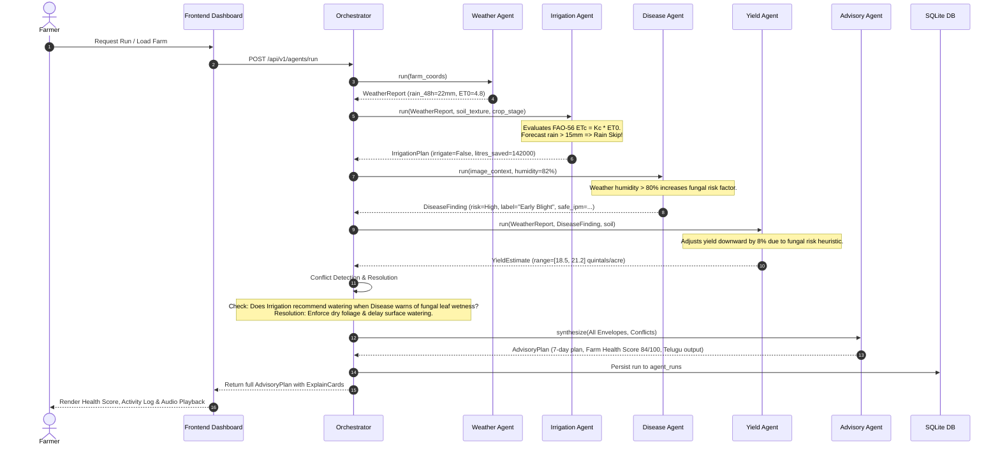

# AgriSage AI — Technical & Functional Specification (`docs/SPEC.md`)

**Yuktik 2026 Hackathon | Version 1.0.0**

---

## 1. Functional Specification for the 12 Application Views & Global Voice Assistant

Every feature is tagged with its operational tier (**Tier 1** or **Tier 2**). Every view displays a `<StatusBadge/>` reflecting its real status (`WORKING`, `PARTIAL`, `DEMO`).

### Global Floating Component: Multilingual Voice Assistant [Tier 1]
- **Placement**: Persistent floating action button (bottom-right on desktop; bottom-nav integrated on mobile) accessible across all 12 views.
- **Capabilities**:
  - *Speech-to-Text (STT)*: Leverages browser Web Speech API (`webkitSpeechRecognition` / `SpeechRecognition`) configured for `en-IN` (Indian English), `te-IN` (Telugu), and `hi-IN` (Hindi).
  - *Text-to-Speech (TTS)*: Uses `window.speechSynthesis` with dynamic voice picker matching user language. Read-aloud trigger available on advisory plans, disease diagnosis cards, and market rankings.
  - *Intent Classification*: User utterances post to `POST /api/v1/voice/query`. Routes to weather, irrigation, disease, economics, schemes, or general advisory services.
  - *Graceful Fallback*: When microphone access is denied or browser lacks speech recognition, transitions smoothly to a typed text input chat dialog with an explanatory banner.

---

### View 1: Welcome & Authentication (`/`, `/login`, `/register`) [Tier 1]
- **Functionality**:
  - Secure registration and login with email/password and JWT bearer token issuance.
  - Role selection: `Farmer`, `Expert`, `Buyer`, `Admin`.
  - **One-Click Demo Mode Button**: Instantly provisions demo session for farmer "Ramesh" (Telangana village, mixed owned/leased holding, cotton previous cycle), sets language to Telugu, and navigates directly to `/dashboard`.
- **Status**: Tier 1 (`WORKING`).

---

### View 2: Location & Language Setup (`/setup`) [Tier 1]
- **Functionality**:
  - Hierarchical selector for State (Telangana, Andhra Pradesh, Maharashtra, Karnataka) → District → Village.
  - Coordinates resolver (latitude/longitude) with Open-Meteo geocoding and local static fallback.
  - Language toggle (`en` English, `te` Telugu, `hi` Hindi) saved to user profile and `localStorage`.
  - Live 7-day weather forecast preview and local agro-climatic zone indicator.
- **Status**: Tier 1 (`WORKING`).

---

### View 3: Farm Profile & Land Tenure Management (`/farms`) [Tier 1]
- **Functionality**:
  - Multi-farm registration per user with spatial coordinates.
  - **Tenure-Aware Field Builder**:
    - `owned`: Collects owned acreage, soil type, water source, and irrigation method.
    - `leased`: Collects leased acreage, annual lease amount (₹/acre), and lessor agreement status.
    - `mixed`: Reveals both owned and leased fields; strictly enforces mathematical validation: `owned_area + leased_area == total_area`.
- **Status**: Tier 1 (`WORKING`).

---

### View 4: Executive Farmer Dashboard (`/dashboard`) [Tier 1]
- **Functionality**:
  - Summary cards: active farm, current crop cycle, phenological growth stage progress bar, and days after sowing (DAS).
  - Real-time weather card: temperature, relative humidity, rainfall probability, and ET0.
  - **Farm Health Score Gauge (0–100)**: Displays composite health score with transparent mathematical breakdown: weather risk, disease status, water status, stage appropriateness, and economics.
  - Active agronomic alerts with severity badges (green / amber / red).
  - **Agent Activity Log Panel**: Real-time sequential timeline of inter-agent messages (Weather → Irrigation → Disease → Yield → Advisory) showing handoff times, inputs used, confidence metrics, and expandable raw JSON viewer.
- **Status**: Tier 1 (`WORKING`).

---

### View 5: Crop Recommendation & Rotation Planner (`/recommend`) [Tier 1]
- **Functionality**:
  - Machine-learned recommendation evaluated on N, P, K, pH, rainfall, temperature, and humidity; displays top-3 crops with individual confidence bars.
  - Missing soil data fallback: clearly flags omitted soil inputs and lowers recommendation confidence score.
  - **Agronomic Crop Rotation Planner**: Analyzes preceding crop cycles to recommend optimal subsequent crops (e.g. pulses/legumes after cotton or cereals for nitrogen fixation; pest-cycle breaking rules).
  - Every recommendation renders `<ExplainCard/>` with explicit "because..." rationale.
- **Status**: Tier 1 (`WORKING`).

---

### View 6: Plant Disease Diagnosis & Crop Protection (`/disease`) [Tier 1]
- **Functionality**:
  - Camera capture and drag-and-drop leaf photo upload.
  - **Input Quality Gate**: Evaluates image sharpness, illumination, and plant presence; rejects blurry or non-leaf photos with diagnostic feedback.
  - **Pretrained CV Inference**: CPU-based classification on PlantVillage classes, yielding top-3 disease candidates with softmax probabilities.
  - **Honest confidence (uncalibrated)**: Discloses PlantVillage lab-image context; returns "uncertain" fallback when confidence is below configured threshold.
  - Safe IPM recommendations from `disease_kb.json` (cultural, biological, and organic steps; zero specific chemical dosages).
  - Telemetry opt-in to log village centroid cluster report to Outbreak Map.
- **Status**: Tier 1 (`WORKING`).

---

### View 7: Irrigation & Weather Intelligence (`/irrigation`) [Tier 1]
- **Functionality**:
  - **FAO-56 Single Crop Coefficient Model**: Calculates $ET_c = K_c \times ET_0$ across 4 growth stages for 10+ Indian crops.
  - Soil water balance bucket simulation incorporating soil texture capacity and irrigation efficiency (flood, furrow, sprinkler, drip).
  - Outputs required irrigation depth (mm), volume in litres for farm area, and next scheduled date.
  - **Rain-Skip Water Conservation**: Detects forecasted rain, triggers irrigation skip, and calculates volume saved.
  - **Problem Diagnosis**: Text keyword matcher (English, Telugu, Hindi) and visual leaf wilting cue analysis (explicitly labelled as surface visual stress, `PARTIAL`).
- **Status**: Tier 1 (`WORKING`).

---

### View 8: Farm Economics & What-If Simulator (`/economics`) [Tier 1]
- **Functionality**:
  - Comprehensive cost-of-cultivation engine: editable line items for seed, fertilizer, pesticide, labour, machinery, irrigation, fuel, transport, storage, lease, and loan interest.
  - Calculates gross revenue, net profit, margin, break-even price, and break-even yield using exact `Decimal` arithmetic.
  - Tenure-separated financial modeling: computes owned land vs leased land economics separately before aggregating for mixed farms.
  - **Interactive What-If Simulator**: Live frontend sliders for crop price, yield, lease rate, and acreage with real-time recalculation and profit sensitivity chart.
  - Side-by-side comparative matrix of top candidate crops.
- **Status**: Tier 1 (`WORKING`).

---

### View 9: Crop Lifecycle Timeline & Calendar (`/calendar`) [Tier 1]
- **Functionality**:
  - Phenological growth-stage timeline in days after sowing (germination, vegetative, flowering, grain-fill/fruiting, maturity).
  - Dated event generator: scheduled irrigation, scouting dates, nutrient windows, and harvest range.
  - In-app notification alerts and browser Notification API opt-in.
  - One-click `.ics` calendar export endpoint for import into external calendar tools.
  - Seasonal Awareness card displaying Kharif, Rabi, or Zaid climatic expectations.
- **Status**: Tier 1 (`WORKING`).

---

### View 10: Community Collaboration & Outbreak Map (`/community`) [Tier 2]
- **Functionality**:
  - Village-level farmer peer discovery (never exposes exact farm coordinates).
  - Farmer groups (create, join, leave) and shared request boards.
  - **Pooled Transport Calculator**: Cost-splitting formula for shared truck logistics based on weight share and distance, displaying individual savings vs solo trip.
  - **Shared Input Purchases**: Bulk ordering pooling for fertilizers (DAP, Urea) and certified seeds.
  - **Opt-in Contact Sharing Flow**: Granular, revocable consent per group with timestamp logging. Unconsented users see only alias and village centroid.
  - **Machinery Rental Hub**: Peer listing of tractors, rotavators, and harvesters with daily/hourly rental rates and haversine distance search.
  - **Named Section: Disease Outbreak Map**: Leaflet map displaying aggregated village-level disease occurrences (minimum 3 reports required to display a cluster pin to preserve privacy).
- **Status**: Tier 2 (`WORKING` with clearly labelled `DEMO` fallback datasets).

---

### View 11: Market Intelligence & Marketplace (`/market`) [Tier 2]
- **Functionality**:
  - Mandi price service querying AGMARKNET API (variety, modal, min, max price, arrival date) with fallback to `datasets/demo/mandi_prices.csv`.
  - **Net Realization Ranking**: Computes `net = (price * quantity) - (distance * freight_rate) - market_fee`, ranking nearby mandis by true take-home revenue.
  - **MSP Comparison Chip**: Cites official Minimum Support Price benchmarks with last-verified dates and flags price variance.
  - Historical price trends and best-time-to-sell advisory.
  - **Farmer-to-Buyer Marketplace**: Harvest listings creation, buyer inquiry messaging, accept/decline workflows, and admin-issued "Verified Seller" badges.
- **Status**: Tier 2 (`WORKING` with clearly labelled `DEMO` fallback datasets).

---

### View 12: Government Schemes, Loans & Soil Health Card (`/schemes`) [Tier 2]
- **Functionality**:
  - Rule-based eligibility matcher for Central and State schemes (PM-KISAN, PMFBY, Rythu Bharosa, KCC) with documented eligibility rationale and official portal links.
  - Institutional loan comparison with user-editable interest rate EMI calculator.
  - PMFBY crop insurance pointer and notification dates.
  - **Named Section: Soil Health Card Upload & Pluggable OCR**: Uploads soil cards, executes regex/fuzzy extraction for N, P, K, pH, EC, and Organic Carbon, and presents an interactive confirmation screen with per-field confidence scores where the farmer confirms values before updating their farm profile.
- **Status**: Tier 2 (`WORKING` with clearly labelled `DEMO` fallback datasets).

---

## 2. Complete Database Schema (SQLAlchemy 2.0 Specifications)

All models include `id` (Integer primary key), timestamp audit columns (`created_at`, `updated_at`), and appropriate indexing.

```python
# Conceptual Table Definitions for backend/app/models/

# 1. users
# id: Integer PK, email: String(255) Unique, hashed_password: String(255), full_name: String(100),
# phone_number: String(20), role: Enum('Farmer', 'Expert', 'Buyer', 'Admin'),
# preferred_language: Enum('en', 'te', 'hi'), is_active: Boolean, created_at: DateTime

# 2. farms
# id: Integer PK, user_id: Integer FK(users.id), name: String(100), area: Float,
# ownership_type: Enum('owned', 'leased', 'mixed'), owned_area: Float, leased_area: Float,
# lease_amount: Float, soil_type: String(50), water_source: String(50),
# irrigation_method: Enum('flood', 'furrow', 'sprinkler', 'drip'), budget: Float,
# village: String(100), district: String(100), state: String(100),
# latitude: Float, longitude: Float, created_at: DateTime

# 3. crops_history
# id: Integer PK, farm_id: Integer FK(farms.id), crop_name: String(100),
# season: Enum('Kharif', 'Rabi', 'Zaid'), year: Integer, yield_obtained: Float,
# profit_realized: Float, created_at: DateTime

# 4. current_crop_cycles
# id: Integer PK, farm_id: Integer FK(farms.id), crop_name: String(100), variety: String(100),
# planting_date: Date, expected_harvest_date: Date,
# current_stage: Enum('germination', 'vegetative', 'flowering', 'fruiting', 'maturity'),
# is_active: Boolean, created_at: DateTime

# 5. weather_cache
# id: Integer PK, latitude_bin: Float, longitude_bin: Float, forecast_json: Text,
# fetched_at: DateTime, expires_at: DateTime (Index on lat/lon bins & expires_at)

# 6. agent_runs
# id: Integer PK, farm_id: Integer FK(farms.id), trigger_type: String(50),
# status: Enum('success', 'degraded', 'failed'), duration_ms: Integer,
# inputs_json: Text, outputs_json: Text, warnings_json: Text, created_at: DateTime

# 7. disease_predictions
# id: Integer PK, farm_id: Integer FK(farms.id) Nullable, user_id: Integer FK(users.id),
# image_path: String(255), crop_hint: String(100), predicted_disease: String(100),
# confidence: Float, top3_json: Text, village: String(100), district: String(100),
# state: String(100), reported_to_outbreak: Boolean, created_at: DateTime

# 8. cost_items
# id: Integer PK, crop_cycle_id: Integer FK(current_crop_cycles.id),
# category: Enum('seed', 'fertilizer', 'pesticide', 'labour', 'machinery', 'irrigation', 'fuel', 'transport', 'storage', 'lease', 'loan_interest', 'other'),
# description: String(255), amount: Numeric(12, 2), is_leased_land_cost: Boolean, created_at: DateTime

# 9. scenarios
# id: Integer PK, farm_id: Integer FK(farms.id), crop_name: String(100),
# price_per_quintal: Numeric(10, 2), expected_yield: Float, total_cost: Numeric(12, 2),
# projected_revenue: Numeric(12, 2), projected_profit: Numeric(12, 2), created_at: DateTime

# 10. mandis
# id: Integer PK, name: String(150), district: String(100), state: String(100),
# latitude: Float, longitude: Float, market_fee_pct: Float, created_at: DateTime

# 11. market_prices
# id: Integer PK, mandi_id: Integer FK(mandis.id), crop_name: String(100),
# variety: String(100), min_price: Numeric(10, 2), max_price: Numeric(10, 2),
# modal_price: Numeric(10, 2), arrival_date: Date, is_demo_data: Boolean, fetched_at: DateTime

# 12. listings
# id: Integer PK, user_id: Integer FK(users.id), farm_id: Integer FK(farms.id),
# crop_name: String(100), variety: String(100), quantity_quintals: Float,
# expected_price: Numeric(10, 2), harvest_date: Date, status: Enum('active', 'inquired', 'sold', 'closed'),
# village: String(100), district: String(100), created_at: DateTime

# 13. inquiries
# id: Integer PK, listing_id: Integer FK(listings.id), buyer_id: Integer FK(users.id),
# offered_price: Numeric(10, 2), message: Text, status: Enum('pending', 'accepted', 'rejected'),
# created_at: DateTime

# 14. ratings
# id: Integer PK, reviewer_id: Integer FK(users.id), reviewee_id: Integer FK(users.id),
# score: Integer, feedback: Text, created_at: DateTime

# 15. farmer_groups
# id: Integer PK, name: String(150), village: String(100), district: String(100),
# leader_id: Integer FK(users.id), description: Text, created_at: DateTime

# 16. group_members
# id: Integer PK, group_id: Integer FK(farmer_groups.id), user_id: Integer FK(users.id),
# consent_share_contact: Boolean (Default False), consent_timestamp: DateTime Nullable,
# joined_at: DateTime (Unique constraint on group_id, user_id)

# 17. shared_requests
# id: Integer PK, group_id: Integer FK(farmer_groups.id), creator_id: Integer FK(users.id),
# request_type: Enum('transport', 'input_purchase', 'pooled_sale'),
# details_json: Text, est_savings_amount: Numeric(10, 2), status: Enum('open', 'filled', 'completed'),
# created_at: DateTime

# 18. machinery
# id: Integer PK, name: String(150), category: Enum('tractor', 'rotavator', 'harvester', 'sprayer', 'other'),
# typical_hourly_rate: Numeric(10, 2), description: Text

# 19. machinery_listings
# id: Integer PK, machinery_id: Integer FK(machinery.id), owner_id: Integer FK(users.id),
# hourly_rate: Numeric(10, 2), daily_rate: Numeric(10, 2), village: String(100),
# latitude: Float, longitude: Float, is_available: Boolean, created_at: DateTime

# 20. schemes
# id: Integer PK, scheme_code: String(50) Unique, name: String(255), authority: String(150),
# category: String(100), eligibility_rules_json: Text, benefits_summary: Text,
# official_url: String(255), is_verified: Boolean, last_verified_date: Date

# 21. loans
# id: Integer PK, institution_name: String(150), product_name: String(150),
# base_interest_rate: Float, max_tenure_months: Integer, max_amount: Numeric(12, 2),
# eligibility_criteria_json: Text, official_url: String(255), last_verified_date: Date

# 22. alerts
# id: Integer PK, user_id: Integer FK(users.id), farm_id: Integer FK(farms.id),
# alert_type: Enum('weather', 'disease', 'irrigation', 'market', 'task'),
# severity: Enum('low', 'medium', 'high', 'critical'), title: String(200),
# message: Text, is_read: Boolean, created_at: DateTime

# 23. tasks
# id: Integer PK, crop_cycle_id: Integer FK(current_crop_cycles.id),
# title: String(200), description: Text, due_date: Date,
# priority: Enum('low', 'medium', 'high'), is_completed: Boolean, created_at: DateTime

# 24. calendar_events
# id: Integer PK, farm_id: Integer FK(farms.id), crop_cycle_id: Integer FK(current_crop_cycles.id),
# event_type: String(50), title: String(200), start_date: Date, end_date: Date,
# notes: Text, created_at: DateTime

# 25. soil_cards
# id: Integer PK, farm_id: Integer FK(farms.id), sample_date: Date,
# nitrogen: Float, phosphorus: Float, potassium: Float, ph: Float,
# electrical_conductivity: Float, organic_carbon: Float, raw_extracted_json: Text,
# confirmed_by_user: Boolean, created_at: DateTime

# 26. chat_history
# id: Integer PK, user_id: Integer FK(users.id), session_id: String(100),
# sender: Enum('user', 'assistant'), text: Text, intent: String(50),
# response_meta_json: Text, created_at: DateTime
```

---

## 3. Entity-Relationship (ER) Diagram



---

## 4. Full API Contract Under `/api/v1`

### Module 1: Auth (`/api/v1/auth`)
- `POST /register`: Registers user. Returns `{id, email, full_name, role}`. (400 if email exists).
- `POST /login`: Authenticates user. Returns `{access_token, token_type: "bearer", user: {...}}`. (401 for bad credentials).
- `POST /demo-login`: One-click provision for "Ramesh" (Telangana farmer). Returns `{access_token, user, farm, active_cycle}`.
- `GET /me`: Returns authenticated user profile. (Requires Bearer token).

### Module 2: Location (`/api/v1/location`)
- `GET /states`: Returns available states.
- `GET /districts?state={state}`: Returns districts in state.
- `GET /villages?district={district}`: Returns villages with lat/lon centroids.
- `GET /geocode?query={text}`: Geocodes query with local fallback.

### Module 3: Weather (`/api/v1/weather`)
- `GET /current?lat={lat}&lon={lon}`: Live temperature, humidity, wind, rainfall probability, and ET0.
- `GET /forecast?lat={lat}&lon={lon}`: 7-day daily forecast chart data with 30-min cache.
- `GET /suitability?crop={crop}&lat={lat}&lon={lon}`: Rule-based suitability classification with reasons.

### Module 4: Farms (`/api/v1/farms`)
- `GET /`: Lists user's registered farms.
- `POST /`: Creates farm. Validates `owned_area + leased_area == area` for `mixed`. (422 if invalid).
- `GET /{id}`: Retrieves single farm profile with recent cycle and soil records.
- `PUT /{id}`: Updates farm attributes.

### Module 5: Agents & Orchestration (`/api/v1/agents`)
- `POST /run`: Triggers full sequential pipeline (Weather → Irrigation → Disease → Yield → Advisory). Returns combined `AdvisoryPlan` and conflict records.
- `GET /runs?farm_id={id}`: Lists historical agent runs with execution time and status.
- `GET /runs/{id}`: Retrieves detailed inputs, outputs, and JSON telemetry for single run.

### Module 5b: Advisory & Growth Stage (`/api/v1/advisory`)
- `GET /stage?crop={crop}&planting_date={YYYY-MM-DD}`: Computes DAS, 5-stage phenological timeline mapped onto FAO-56 4 stages, stage progress %, cycle progress %, and next stage countdown.
- `GET /tasks?crop={crop}&planting_date={YYYY-MM-DD}`: Returns stage-appropriate agronomic tasks (fertilizer window, scouting, spraying window, irrigation sensitivity) as general guidance with zero chemical dosages.
- `POST /plan`: Synthesizes or retrieves the full coordinated `AdvisoryPlan` (7-day action plan with agent tracing and explainable "because..." rationales, transparent 5-component Farm Health Score formula, headline yield, risk alerts).

### Module 6: Disease Diagnosis (`/api/v1/disease`)
- `POST /predict`: Multipart form image upload (`file`, `crop_hint`, `farm_id`). Evaluates quality gate, runs CV model, returns top-3 classes, confidence, and safe IPM steps.

### Module 7: Irrigation (`/api/v1/irrigation`)
- `POST /plan`: Runs FAO-56 single crop coefficient model ($ET_c = K_c \times ET_0$). Returns next watering date, depth (mm), litres required, and rain-skip litres saved.
- `POST /diagnose`: Accepts text query (en/te/hi) and/or leaf image; classifies problem and returns remediation advice.

### Module 8: Yield (`/api/v1/yield`)
- `POST /predict`: Predicts yield range (`lower_bound`, `expected_yield`, `upper_bound`) for given crop, district, season, area, and weather factors.

### Module 9: Economics (`/api/v1/economics`)
- `POST /calculate`: Calculates total cost per acre, revenue, gross/net profit, and break-even points, evaluating owned and leased tenure separately using `Decimal`.
- `GET /compare?crops=cotton,groundnut,chilli`: Returns comparative economics matrix for candidate crops.
- `POST /what-if`: Instant recalculation endpoint for live slider sensitivity simulations.

### Module 10: Crop Recommendation (`/api/v1/recommend`)
- `POST /crop`: Evaluates N, P, K, pH, rainfall, and temperature; returns top-3 recommended crops with reasons and missing soil indicators.

### Module 11: Crop Rotation (`/api/v1/rotation`)
- `GET /recommend?previous_crop={crop}`: Recommends subsequent crop rotation choices citing soil restoration and pest-breaking logic.

### Module 12: Market Intelligence (`/api/v1/market`)
- `GET /prices?crop={crop}&district={district}`: Returns AGMARKNET modal, min, max prices with demo fallback indicator.
- `GET /ranking?crop={crop}&lat={lat}&lon={lon}&quantity={qty}`: Ranks nearby mandis by net realization taking transport and fees into account.
- `GET /msp`: Returns official Minimum Support Price benchmarks.

### Module 13: Marketplace (`/api/v1/marketplace`)
- `GET /listings`: Lists active harvest listings.
- `POST /listings`: Creates listing (crop, quantity, expected price, harvest date).
- `POST /inquiries`: Buyer submits inquiry on listing.
- `PUT /inquiries/{id}/status`: Farmer accepts or rejects buyer inquiry.

### Module 14: Community (`/api/v1/community`)
- `GET /groups`: Lists farmer groups in village centroid.
- `POST /groups`: Creates farmer group.
- `POST /groups/{id}/join`: Joins group with explicit `consent_share_contact` toggle.
- `POST /requests/transport`: Creates pooled truck request with cost-split breakdown.

### Module 15: Machinery (`/api/v1/machinery`)
- `GET /catalog`: Lists machinery categories and stage requirements.
- `GET /listings?lat={lat}&lon={lon}`: Search machinery listings ranked by distance.
- `POST /listings`: Farmer lists machine for rent.

### Module 16: Schemes (`/api/v1/schemes`)
- `GET /match?farm_id={id}`: Matches farm profile against government scheme criteria with eligibility explanation.
- `GET /{id}`: Detailed benefits and application guide for a specific scheme.

### Module 17: Loans (`/api/v1/loans`)
- `POST /calculate-emi`: Returns loan estimate and EMI breakdown for user-entered interest rate.
- `GET /products`: Lists institutional loan products with verification notes.

### Module 18: Outbreak Telemetry (`/api/v1/outbreaks`)
- `GET /map?district={district}&days={days}`: Returns aggregated village-level disease occurrences (minimum threshold of 3 reports applied).

### Module 19: Calendar (`/api/v1/calendar`)
- `GET /events?cycle_id={id}`: Returns dated calendar events for active crop cycle.
- `GET /export.ics?cycle_id={id}`: Generates valid RFC 5545 `.ics` file for download.
- `GET /season?lat={lat}&lon={lon}`: Returns current season (Kharif/Rabi/Zaid) context.

### Module 20: Soil Health Card (`/api/v1/soil-card`)
- `POST /ocr`: Pluggable OCR endpoint extracting N, P, K, pH, EC, and OC from card image with per-field confidence.
- `POST /confirm`: Commits confirmed soil values to farm profile.

### Module 21: Voice (`/api/v1/voice`)
- `POST /query`: Processes speech transcript or typed query in English, Telugu, or Hindi, returning spoken-length response and structured action link.

### Module 22: Chat (`/api/v1/chat`)
- `GET /history`: Returns conversation thread history.
- `POST /message`: General agricultural Q&A with strict safety boundaries (no chemical dosing, no guarantees).

### Module 23: Dashboard (`/api/v1/dashboard`)
- `GET /summary?farm_id={id}`: Consolidated payload delivering health score, weather alerts, growth stage, active tasks, and recent agent runs.

### Module 24: Health (`/api/v1/health`)
- `GET /`: Returns `{"status": "healthy", "version": "1.0.0", "timestamp": "..."}`.

---

## 5. Multi-Agent Framework & Orchestration Flow

### The `AgentEnvelope` Schema
Every agent consumes and produces this standard Pydantic model:
```json
{
  "agent_name": "WeatherAgent",
  "status": "success",
  "timestamp": "2026-11-13T01:07:00Z",
  "inputs_used": {
    "latitude": 17.38,
    "longitude": 78.48,
    "crop": "cotton"
  },
  "outputs": {
    "temperature": 28.5,
    "relative_humidity": 82.0,
    "rain_forecast_48h_mm": 22.0,
    "reference_et0_mm": 4.8
  },
  "confidence": 0.95,
  "warnings": [
    "High rainfall anticipated in 36h"
  ]
}
```

### Orchestrator Sequential Flow & Conflict Resolution


---

## 6. Universal Explainability Schema

Every recommendation rendered in the UI or returned from an API route complies with:
```json
{
  "value": "Skip irrigation for the next 48 hours",
  "confidence": 0.92,
  "confidence_type": "rule",
  "reasons": [
    "Forecasted precipitation of 22 mm exceeds the 14 mm soil moisture deficit",
    "Single crop coefficient Kc for vegetative cotton is 0.75"
  ],
  "sources": [
    "Open-Meteo Global Forecast (17.38, 78.48)",
    "FAO Irrigation and Drainage Paper No. 56"
  ],
  "status": "WORKING",
  "limitations": [
    "Weather forecasts beyond 48 hours are subject to atmospheric variability",
    "Soil texture is assumed based on regional classification"
  ]
}
```

